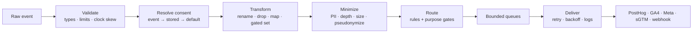

<div align="center">

# PyTagShield

**Consent-aware, privacy-minimizing analytics events — with a Rust core and a Python API.**

Validate → resolve consent → transform → minimize → route → deliver.  
Fail closed by default. Pseudonymize before egress. No vendor lock-in.

[](https://pypi.org/project/pytagshield/)
[](https://pypi.org/project/pytagshield/)
[](./LICENSE)
[](https://www.rust-lang.org/)
[](#status-and-roadmap)

[Quick start](#quick-start) · [Configuration](#configuration) · [Destinations](#destinations) · [Privacy model](#privacy-model) · [Python API](#python-api) · [Contributing](#contributing)

</div>

---

> **Status: alpha.** The Rust core and Python bindings are implemented and
> tested (113 tests in the workspace). PyPI wheels currently target CPython
> 3.10+ on macOS arm64; other platforms build from source. The HTTP server is
> runnable: it loads validated YAML, starts bounded delivery workers, and shuts
> down gracefully on SIGINT/SIGTERM.

## Why PyTagShield

Most analytics stacks collect first, then ask questions about consent and PII
later. That is backwards: by the time an event reaches GA4, Meta or PostHog, the
data has already left your boundary.

PyTagShield runs the privacy-sensitive stages **before** egress:

- **Consent is a gate, not a report.** A destination receives an event only when
  its required purpose is granted. The default policy is `deny`, and precedence
  is explicit: event payload → stored consent → configured default.
- **Minimize before sending.** Drop or allowlist properties, cap count and depth,
  truncate strings, clear IPs, and pseudonymize identifiers with a salted hash.
- **Deterministic transforms.** Rename, drop and map always run. Enrichment
  (`set`) runs only when at least one purpose is granted.
- **Bounded delivery.** Per-destination queues, explicit backpressure, timeouts,
  exponential backoff and a bounded delivery log. Overload is visible, never
  silent.
- **One core, two surfaces.** Rust crates for your ingest service and a Python
  package for scripts, tests and pipelines.

## Quick start

```bash
pip install pytagshield
```

Requires CPython 3.10+. The published wheel is abi3 (macOS arm64 today); on other
platforms, build from source (see [Development](#development)).

```python
import pytagshield

CONFIG = """
consent:
  purposes: [analytics, advertising]
  default_policy: deny

minimization:
  pseudonymize_salt: "change-me"
  forward_ip: false

destinations:
  - name: ph
    type: posthog
    purpose: analytics
    posthog:
      api_key: "phc_..."

routes:
  - name: analytics
    match:
      events: ["page_view", "signup"]
    destinations: [ph]
"""

pipeline = pytagshield.Pipeline(pytagshield.Config.from_yaml(CONFIG))

result = pipeline.process(
    {
        "event": "page_view",
        "distinct_id": "user-42",
        "properties": {
            "email": "a@b.c",       # dropped by default
            "url": "/pricing",
        },
        "consent": {"analytics": True},
    }
)

print(result["routing"]["destinations"])             # ['ph']
print(result["event"]["distinct_id"])                # 'sha256:...'
print(result["minimization"]["properties_dropped"])  # 1
```

`process()` is synchronous and side-effect free: it validates, resolves consent,
transforms, minimizes and routes. Destination queues are a transport concern, so
the caller keeps explicit control over backpressure.

Store and reuse consent decisions:

```python
pipeline.set_consent("user-42", {"analytics": True, "advertising": False})
print(pipeline.get_consent("user-42"))
print(pipeline.metrics())  # Prometheus text
```

Run the HTTP server from the same validated YAML:

```bash
cargo run -p pytagshield-server -- config.yaml
# or
PYTAGSHIELD_CONFIG=config.yaml cargo run -p pytagshield-server
```

The server exposes `/api/v1/event`, `/api/v1/batch`, `/api/v1/consent`,
`/healthz`, and Prometheus `/metrics`, with optional bearer-token auth,
bounded queues, and graceful SIGINT/SIGTERM shutdown.

## How the pipeline works



Every stage reports what it did: consent source, matched routes, skipped
destinations with reasons, transform counts, minimization counts and delivery
outcomes. Nothing is silently discarded.

## Configuration

Configuration is strict YAML: unknown fields fail startup instead of being
ignored. The main sections are:

| Section | Controls |
| --- | --- |
| `server` | Listen address, body limit, concurrency limit |
| `ingest` | Bearer token, required IDs, batch size, timestamp skew, event/property limits |
| `consent` | Purposes, default policy (`deny`/`allow`), store TTL and capacity |
| `minimization` | Pseudonymization salt, drop/allowlist, property/depth/string caps, IP forwarding |
| `transforms` | Ordered `rename` / `drop` / `set` / `map` rules with optional match clauses |
| `attribution` | Preserve click IDs (`gclid`, `fbclid`, `msclkid`, `ttclid`, …) into canonical keys |
| `destinations` | PostHog, GA4, Meta Conversions API, server-side GTM, webhook or log |
| `routes` | Event-name wildcards and property matching; maps events to destinations |
| `delivery` | Queue capacity, timeout, attempts, backoff and log capacity |

A destination is only dispatched when a route matched **and** the destination is
enabled **and** its required purpose is granted.

Outbound webhook events carry the versioned `pytagshield.consent.v1` block:
granted purposes (`consent`), the full decision map (`consent_decisions`), and
provenance (`consent_source`: `event`, `stored`, or `default`). Consent attaches
to events, never to CRM records; see
[docs/squid-consent-contract.md](docs/squid-consent-contract.md).

## Destinations

| Type | Protocol |
| --- | --- |
| `posthog` | PostHog `/capture/` |
| `ga4` | GA4 Measurement Protocol `/mp/collect` |
| `meta` | Meta Conversions API `/{pixel_id}/events` |
| `sgtm` | Server-side GTM-style `/g/collect` endpoint |
| `webhook` | JSON delivery to your own endpoint with custom headers |
| `log` | Local, side-effect-free routing diagnostics |

Credentials are configuration values, not command-line arguments. Keep them in a
secret manager or environment-substituted config, and never commit them.

## Privacy model

| Concern | Default behaviour |
| --- | --- |
| Consent | `deny` unless a purpose is explicitly granted |
| Identifier egress | `distinct_id` pseudonymized with SHA-256 + salt |
| PII properties | Common email/phone/name/address/IP keys dropped |
| Client IP | Cleared before egress unless `forward_ip` is enabled |
| Event size | Property count, nesting depth and string length capped |
| Destination consent | Per-destination `purpose` required before dispatch |
| Attribution | Click-ID preservation is opt-in and can require consent |

This is not a compliance certificate. It is a small, auditable data plane that
makes the privacy-preserving path the default path. Review the configuration and
your legal basis before production use.

## Python API

| Object | Members |
| --- | --- |
| `Config` | `from_yaml`, `from_path`, `purposes`, `default_policy` |
| `Pipeline` | `process`, `set_consent`, `get_consent`, `consent_entries`, `metrics` |
| Errors | `ValidationError` (with `.errors`), `ConfigError` |

`process(payload, ip=None, user_agent=None)` returns a dict with the normalized
`event`, resolved `consent`, `routing`, `transforms`, `attribution` and
`minimization` reports.

## Development

```bash
git clone https://github.com/Mullassery/PyTagShield.git
cd PyTagShield

cargo test --workspace
cargo clippy --workspace --all-targets -- -D warnings
cargo fmt --all -- --check
```

Build the Python extension from source:

```bash
python -m venv .venv && source .venv/bin/activate
pip install maturin
maturin build --release -m crates/pytagshield-python/Cargo.toml --out dist
pip install dist/*.whl
python crates/pytagshield-python/tests/test_binding.py
```

| Crate | Responsibility |
| --- | --- |
| `pytagshield-core` | Validation, consent, transforms, minimization, routing, delivery |
| `pytagshield-python` | PyO3 bindings published as `pytagshield` |
| `pytagshield-server` | Runnable Axum ingest server: config validation, delivery workers, auth, health, metrics, graceful shutdown |

## Status and roadmap

- [x] Core pipeline: validation, consent, transforms, minimization, routing
- [x] Destinations: PostHog, GA4, Meta CAPI, sGTM, webhook, log
- [x] Bounded delivery workers with retries and exponential backoff
- [x] Python bindings and PyPI package
- [x] Click-ID preservation and Prometheus metrics
- [x] Wire the HTTP server binary
- [ ] Publish container images
- [ ] Publish Linux and Windows wheels
- [ ] Pluggable persistent consent store (Redis/Postgres)
- [ ] Additional destinations and configurable schemas
- [ ] Benchmarks and a documented performance envelope

## Contributing

Contributions are welcome: new destinations, privacy-focused tests, fuzz targets
for the event parser and config loader, and documentation. Open an issue with the
use case before large changes.

If PyTagShield is useful to you, **star the repo** — it helps other teams find a
consent-first alternative to collect-now-filter-later pipelines.

## License

Apache-2.0 — see [`LICENSE`](./LICENSE).
